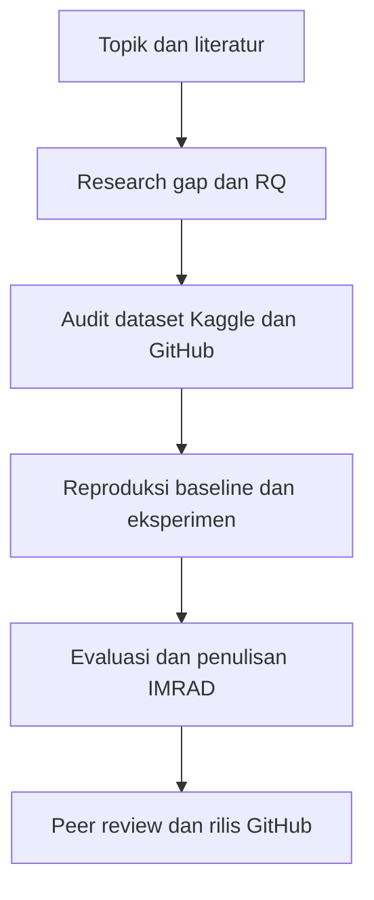

# Evaluating the Robustness of Machine Learning-Based Phishing URL Detection Using URL Feature Selection and Domain-Aware Validation

Proyek Tata Tulis Karya Ilmiah (TTKI), Sarjana Terapan Teknik Informatika, Politeknik Elektronika Negeri Surabaya (PENS), semester 5. Topik P1: Phishing URL Detection.

## Anggota kelompok
- Faira Fidelia Novatiara (NRP 3124600062): koordinator eksperimen dan reproduksibilitas
- Amalia Chasanah Zahty (NRP 3124600088): koordinator literatur dan penulisan

## 1. Tujuan dan research question
- Research question: Bagaimana pengaruh pemilihan fitur leksikal URL dan protokol validasi berbasis kelompok domain terhadap F1-score, ROC-AUC, dan waktu inferensi model deteksi phishing pada dataset PhiUSIIL?
- Hipotesis:
  - H1: Validasi berbasis kelompok domain menghasilkan F1-score dan ROC-AUC yang lebih rendah daripada random split.
  - H2: Penggunaan fitur URL saja mempercepat waktu inferensi dibandingkan fitur lengkap (URL dan isi halaman).

Alur kerja proyek:



## 2. Sumber data
- Dataset: PhiUSIIL Phishing URL Dataset (Kaggle)
- Tautan: https://www.kaggle.com/datasets/kaggleprollc/phishing-url-websites-dataset-phiusiil
- Tanggal unduh: 19 November 2026
- Lisensi dataset: CC BY-SA 4.0 (https://creativecommons.org/licenses/by-sa/4.0/)
- SHA-256 berkas CSV: `a236549cd369cd80bd478ff8e1779cbf44c58d5c3f79f7a51a1adbed7d06d1c6`
- Sumber publikasi dataset: Prasad & Chandra (2024), Computers & Security, 136, 103545. DOI: 10.1016/j.cose.2023.103545
- Ukuran: 235.795 baris dan 56 kolom. Kolom `label`: 1 = legitimate (134.850 baris), 0 = phishing (100.945 baris).
- File CSV tidak disertakan di repositori. Lihat `data/README.md`.

## 3. Environment
- OS: Windows 11
- Python: 3.11.9
- Paket: lihat `requirements.txt` dan `environment-freeze.txt`

```
python -m venv .venv
# Windows: .venv\Scripts\activate
# Linux/macOS: source .venv/bin/activate
pip install -r requirements.txt
```

## 4. Cara mengunduh data
1. Buka tautan dataset di Kaggle dan unduh berkas zip.
2. Ekstrak berkas zip tersebut.
3. Letakkan `PhiUSIIL_Phishing_URL_Dataset.csv` di folder `data/`.

## 5. Urutan menjalankan
1. `notebooks/01_eda.ipynb`: pemeriksaan data (bentuk, kelas, nilai hilang, duplikat, domain).
2. `notebooks/02_baseline.ipynb`: baseline (Skenario A).
3. `notebooks/03_experiment.ipynb`: Skenario B, Skenario C, uji kebocoran, dan ulangan seed.

Jalankan dari folder `notebooks/`. Kode fungsi berada di `src/preprocessing.py` dan `src/evaluation.py`.

## 6. Seed dan pembagian data
- Seed: 42 untuk pembagian data dan model. Untuk Skenario B dan C, percobaan diulang dengan seed 42, 1, 2, 3, dan 4 (`results/metrics_seeds.csv`).
- Pembersihan: 425 baris dengan URL duplikat dibuang sebelum pembagian data (235.795 menjadi 235.370 baris). Kelas positif adalah phishing.
- Pembagian: 80% data latih dan 20% data uji. Metrik validasi dihitung dengan 5-fold cross-validation di dalam data latih. Data uji hanya dipakai satu kali untuk evaluasi akhir.
- Model: Logistic Regression (dengan StandardScaler di dalam pipeline, `max_iter=1000`) dan Random Forest (parameter bawaan, 100 pohon).
- Skenario A: seluruh 50 fitur numerik (fitur URL dan fitur isi halaman), tanpa kolom teks/identitas dan target. Pembagian stratified random split.
- Skenario B: 18 fitur leksikal yang dihitung dari string URL. Pembagian stratified random split.
- Skenario C: 18 fitur yang sama dengan Skenario B. Pembagian dengan GroupShuffleSplit berdasarkan kolom Domain (awalan "www." dibuang), dan cross-validation dengan GroupKFold.
- Uji tambahan: Skenario A tanpa fitur `URLSimilarityIndex`, untuk menguji kebocoran label.

## 7. Keluaran
- `results/metrics.csv`: metrik semua skenario (seed 42)
- `results/metrics_seeds.csv`: metrik B dan C pada lima seed
- `figures/`: confusion matrix tiap skenario dan model
- `docs/feature_groups.csv`: pemetaan kolom ke kelompok fitur dan skenario
- `references/literature_matrix.csv`: matriks 8 literatur
- `paper/draft.docx`: draf paper

## 8. Atribusi dan lisensi
- Repositori referensi baseline: https://github.com/pradhyumnaag30/PhiUSIIL-Phishing-URL-Detection (hanya sebagai acuan; seluruh hasil di sini berasal dari eksperimen sendiri).
- Lisensi kode: MIT (lihat berkas `LICENSE`). Lisensi dataset berbeda dan tercantum pada bagian 2.

## 9. Penggunaan alat bantu AI
Kode di `src/` dan `notebooks/` disusun dengan bantuan Claude (Anthropic). Seluruh kode dijalankan dan diperiksa oleh penulis, dan seluruh angka dalam `results/` berasal dari hasil eksekusi penulis.
